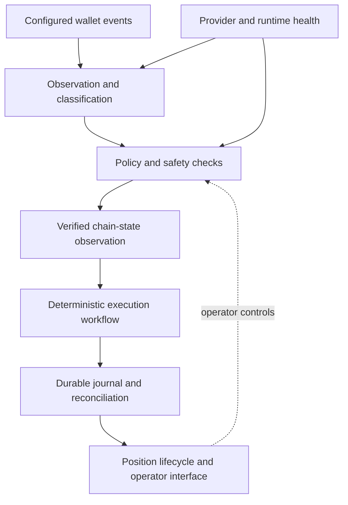

# Project 91 — Solana Event-Driven Systems

**A closed-source engineering case study in Rust, blockchain event processing, stateful execution, and production reliability.**

> **Portfolio / architecture showcase — not a source-code release or a trading service.** The underlying application and its confidential implementation are not distributed here. Only reviewed, high-level documentation and approved demo media are intended for publication.

## The project in one minute

Project 91 is a client-oriented, event-driven Solana application designed to observe configured wallet activity, classify relevant transactions, evaluate deterministic policy gates, and maintain durable transaction and position state. An operator-facing interface runs on Windows, while the core Rust services run in Ubuntu through WSL2.

The engineering challenge was not simply detecting on-chain events. It was building a system that handles uncertain network observations, evolving protocols, interrupted processes, and ambiguous transaction outcomes without silently corrupting state or duplicating operations.

| Area | Engineering focus |
|---|---|
| Core implementation | Rust workspace with **19 crates** |
| Runtime | Asynchronous event processing and blockchain data observation |
| Reliability | Fail-closed state transitions, duplicate suppression, bounded recovery |
| Data persistence | SQLite journals, reconciliation, and position lifecycle |
| Integration | Windows launcher, local operator interface, Ubuntu/WSL2 backend |
| Validation | Focused tests, no-spend mainnet simulation, reconciled on-chain sell, launcher self-test |

## High-level architecture

*Conceptual illustration only. The actual execution engine, provider configuration, private integration details, and transaction construction are intentionally excluded.*

## What made the engineering difficult?

### 1. Reliable provider replay and restart behavior
A stored stream position can outlive a provider's retained history. The recovery design needed to differentiate an actual replay-retention error from generic timeouts, establish evidence before any state movement, and preserve durable financial state.

### 2. Evolving on-chain account layouts
Strict parsers are valuable because they reject unknown data, but they must also be updated when protocol-defined account layouts evolve. Compatibility updates were based on observed account structures and reviewed protocol evidence rather than permitting arbitrary trailing bytes.

### 3. Durable outcomes instead of optimistic UI states
Submission, confirmation, and final reconciliation are different states. Journaling and reconciliation prevented the interface from simply treating a delayed response as proof of success or failure.

### 4. Deploying a Rust backend as a Windows-facing product
The packaging boundary separates the launcher and operator controls from the Rust backend and its sensitive configuration. The launcher is not itself authorization for financial actions.

Read the engineering [case studies](docs/CASE_STUDIES.md) and [architecture decisions](docs/ARCHITECTURE.md).

## Validation: what was actually demonstrated?

- **Supported SOL-paired buy construction:** successful no-spend mainnet simulation with validated token effect; no wallet signing, broadcast, or real asset spend in that diagnostic.
- **Manual Sell workflow:** one real sell confirmed on-chain and consistently reconciled into durable state.
- **Windows launcher:** reviewed build and non-spending self-test passed.

These are scoped historical validation results, **not** a claim that every venue, token pair, transaction, or current live environment has been tested. See [validation scope and limitations](docs/VALIDATION.md).

## Product demonstration

An approved, sanitized video or screenshots can be added here after permission and confidentiality review. Demo material will focus on operator experience, architectural boundaries, and engineering quality — not trading advice or profit claims.

- [Demo storyboard and privacy checklist](docs/DEMO_SCRIPT.md)
- [Media requirements](media/README.md)

## Stack

`Rust` · `Tokio` · `Solana` · `gRPC/stream observation` · `SQLite` · `WSL2/Ubuntu` · `Windows launcher` · `Local operator UI`

## Project boundaries and ownership

This public repository is a **documentation-only engineering portfolio**. It does not contain the application source, trading strategy implementation, provider credentials, private configuration, wallet data, production database, or client assets. It is not a runnable copy and does not offer access to trading features.

**Publication is subject to the applicable client agreement and permission to disclose project information.** This repository does not grant a license to use or reproduce any underlying proprietary application code. Rights in the original software and brand belong to their respective owners.

**Author / contribution:** [Replace with your name and an accurate, permission-cleared description of your personal role.]

**Contact:** [Add an appropriate professional portfolio or LinkedIn profile only if desired.]
